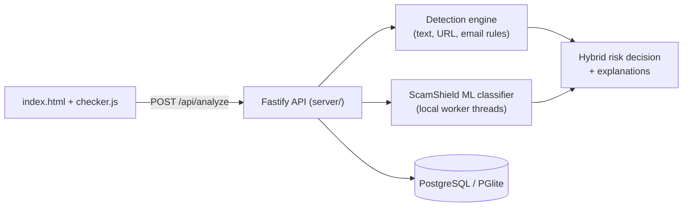
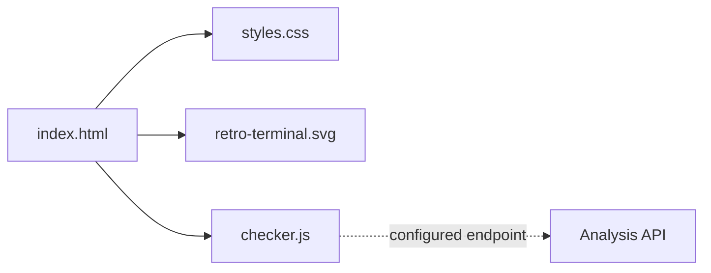
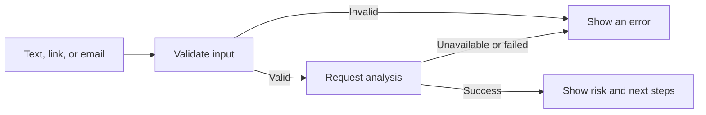

# ScamShield

ScamShield is a browser interface for checking suspicious messages, links, and emails, backed by an explainable scam-detection API. The frontend uses HTML, CSS, and JavaScript; the backend uses TypeScript on Node.js.

**ScamShield uses its own trained machine-learning classifier, not an external AI API.** The model was trained and evaluated by the team on public datasets with documented sources and licences, and runs locally inside the backend. Submitted content is never sent to Anthropic, OpenAI, Google, or any other AI provider.

## 1. Project overview

Users paste a suspicious text message, link, or email (or upload a screenshot) and get a risk rating (`low`, `medium`, `high`, or `unknown`), the warning signs found with evidence, and safety recommendations. Results are an automated estimate: ScamShield never claims something is safe or definitively fraudulent.

## 2. Features

- Rule-based detection of urgency, threats, credential/OTP/bank/card requests, unusual payments, impersonation, fake deliveries, account-suspension notices, prizes, investment and job scams, phishing calls-to-action, and obfuscation tricks, in **English and Arabic**.
- Static URL analysis (look-alike brands, punycode/mixed scripts, IP hosts, embedded credentials, misleading subdomains, redirects, and more). URLs are never visited.
- Pasted-email sender consistency checks (explicitly unverified).
- **ScamShield's own ML text classifier** (TF-IDF word + character n-grams, logistic regression) trained on public SMS spam, smishing, phishing, and legitimate-message datasets. It runs locally in worker threads, explains which words moved its score, and is combined with the rules by a transparent hybrid policy. English only (see [limitations](docs/MODEL_LIMITATIONS.md)).
- Accounts with email verification, password reset, opt-in scan history, downloadable reports, feedback, and account deletion.
- Educational articles, an admin API with audit logs, and screenshot OCR (optional).

## 3. Backend technology stack

TypeScript · Node.js ≥ 22.12 · Fastify 5 · Zod · PostgreSQL (`pg`) with embedded PGlite for development/tests · Argon2id · `tldts` · `tesseract.js` · `nodemailer` · Vitest · ESLint.

ML training and evaluation (offline only, not needed to run the server): Python 3 · scikit-learn · pandas · NumPy · pytest.

## 4. Architecture



Details: [`docs/BACKEND_ARCHITECTURE.md`](docs/BACKEND_ARCHITECTURE.md) and [`docs/ML_ARCHITECTURE.md`](docs/ML_ARCHITECTURE.md).

### Frontend structure



### Scan flow



## 5. Folder structure

```
index.html, styles.css, checker.js, retro-terminal.svg   frontend (owned by the frontend developer)
server/          backend source (routes, detection, risk, ml, auth, repositories, db, ocr, reports, scripts)
ml/              ML training pipeline (Python), challenge probes, and the trained model in ml/artifacts/
tests/           unit/, integration/, security/, helpers/, fixtures/
docs/            backend and ML documentation
FRONTEND_INTEGRATION.md   how to connect the frontend to the API
FRIEND_HANDOFF.md         current status and next steps
```

## 6. Installation

1. Clone the repository.

   ```sh
   git clone https://github.com/nourelhilo/scam-shield.git
   cd scam-shield
   ```

2. **Frontend only:** open `index.html` in a browser. For a local server, run this from the folder containing `index.html` with Python 3 installed, then open [localhost:4173](http://127.0.0.1:4173).

   ```sh
   python -m http.server 4173 --bind 127.0.0.1
   ```

3. **Backend (and frontend together):** with Node.js 22.12 or newer:

   ```sh
   npm install
   cp .env.example .env     # optional; defaults work for local development
   npm run dev              # http://127.0.0.1:3000 serves the page and the API
   ```

   No database server is needed locally: an embedded PostgreSQL (PGlite) is created in `.data/pglite` and migrated and seeded automatically. The trained model ships in `ml/artifacts/` and loads automatically. **Python is not needed to run the server**, only to retrain the model.

## 7. Environment variables

All variables are server-only. They are documented in [`.env.example`](.env.example). The most important:

| Variable | Default | Purpose |
|---|---|---|
| `DATABASE_URL` | empty (uses PGlite) | PostgreSQL connection string; **required in production** |
| `ML_ENABLED` | `true` | Use ScamShield's own ML classifier (`false` = rules only) |
| `ML_TIMEOUT_MS` / `ML_MAX_QUEUE` / `ML_WORKERS` | `1500` / `64` / `1` | Inference timeout, queue bound, worker threads |
| `CORS_ORIGINS` | dev: `127.0.0.1:4173`, `localhost:4173`, `:3000` | Allowed frontend origins |
| `PUBLIC_APP_URL` | `http://127.0.0.1:3000` | Base URL for links in emails |
| `MAIL_TRANSPORT` / `SMTP_URL` | `console` | Email delivery (`smtp` is required in production) |
| `REQUIRE_EMAIL_VERIFICATION` | `true` | Block sign-in until the email is verified |
| `OCR_ENABLED` | `false` | Enable screenshot analysis |
| `TRUST_PROXY` | `false` | Set behind a trusted reverse proxy |

`ANTHROPIC_API_KEY`, `AI_PROVIDER`, and `AI_MODEL` are **no longer used**. If they are still set, the server ignores them and logs a warning.

## 8. Development commands

| Command | What it does |
|---|---|
| `npm run dev` | Start the API with auto-reload |
| `npm start` | Start the API |
| `npm test` | Run all tests |
| `npm run typecheck` / `npm run lint` / `npm run check` | Type check / lint / all checks |
| `npm run db:migrate` | Apply database migrations (forward-only) |
| `npm run db:seed` | Insert starter articles (idempotent) |
| `npm run admin:promote -- you@example.com [--revoke]` | Grant or revoke the admin role |
| `npm run ml:setup` | Create `ml/.venv` with the pinned Python packages |
| `npm run ml:pipeline` | Download (checksum-verified) → prepare → train → evaluate the model |
| `npm run ml:test` | Python ML tests |

There is no build step: the server runs TypeScript directly. Training instructions: [`docs/MODEL_TRAINING.md`](docs/MODEL_TRAINING.md).

## 9. API documentation

- Frontend guide with examples: [`FRONTEND_INTEGRATION.md`](FRONTEND_INTEGRATION.md)
- Field-level reference and rule catalogue: [`docs/API_DOCUMENTATION.md`](docs/API_DOCUMENTATION.md)

### Connect the analyzer

Run `npm run dev` and open `http://127.0.0.1:3000`; the served page is wired to `/api/analyze` automatically. Alternatively, set `data-analysis-endpoint` on `#scan-form` in `index.html` (for example `http://127.0.0.1:3000/api/analyze` when the page is served from `python -m http.server`). The frontend sends `POST` with JSON `{ "type": "text", "content": "Your delivery is on hold." }`. Supported types are `text`, `url`, and `email`.

A successful response includes this shape (plus richer fields such as `riskLevel`, `indicators`, `analysisMethod`, `mlPrediction`, `modelExplanation`):

```json
{
  "risk": "unknown",
  "summary": "There is too little information to assess this message.",
  "warnings": [],
  "recommendations": ["Check your delivery status in the retailer's official app."]
}
```

The risk values are `low`, `medium`, `high`, and `unknown`. If the API runs on a separate origin, list the frontend origin in `CORS_ORIGINS`.

## 10. Authentication

Email + password accounts. Passwords are hashed with Argon2id. Sign-in returns an opaque bearer token (only its hash is stored) that is sent as `Authorization: Bearer <token>`. Email verification and password reset use single-use, expiring tokens. Accounts are optional: analysis works without signing in.

## 11. Database setup

- **Development:** nothing to do (PGlite in `.data/pglite`).
- **Production:** create a PostgreSQL database, set `DATABASE_URL`, then run `npm run db:migrate` and `npm run db:seed`. Migrations are forward-only and never drop data.

Schema: [`docs/DATABASE_SCHEMA.md`](docs/DATABASE_SCHEMA.md).

## 12. Scam detection approach

1. **Normalise** text (Unicode NFKC, remove invisible characters, unify Arabic letter variants and digits, detect language).
2. **Run independent rules.** Each rule has an ID, severity, description, and evidence. Request rules require a request verb near a sensitive noun and are suppressed by negations, so "we will never ask for your password" is not flagged.
3. **Analyse every link** statically and, for emails, check sender consistency.
4. **Score the rules:** low = 1, medium = 2, high = 3, with repeats in one category dampened. **HIGH** needs a score ≥ 6 across 2+ categories, or 2 high-severity indicators in different categories. **MEDIUM** needs a score ≥ 3 or one high-severity indicator.
5. **Run ScamShield's ML classifier** on English text and email (subject + body). It returns a score, a band (`low` < 0.2 · `uncertain` · `elevated` ≥ 0.5 · `strong` ≥ 0.9), and the words that moved the score. URLs are left to the URL engine; Arabic and mixed text are left to the rules.
6. **Combine (hybrid).** The rule level is the anchor. A `strong` ML score raises it one step (LOW→MEDIUM, MEDIUM→HIGH). An `elevated` score raises LOW→MEDIUM only when a rule also found something. ML **never lowers** a rule finding and **never produces HIGH on its own**. If the model cannot run (failure or unsupported language) and the rules found nothing, the result is **UNKNOWN**, because the absence of findings is not proof of safety. One keyword never decides a result, and no confidence percentages are shown.
7. **Explain** deterministically from the final indicators, with tailored recommendations.

## 13. Machine-learning model

| | |
|---|---|
| Model | `scamshield-text-v1.0.0`: logistic regression over word 1–2-grams + character 3–5-grams (80,000 features) |
| Training data | UCI SMS Spam Collection, Mishra & Soni SMS phishing set, Nazario phishing corpus, SpamAssassin public corpus: 14,728 unique English messages after de-duplication ([sources and licences](docs/DATASET_SOURCES.md)) |
| Compared against | Linear SVM, multinomial naive Bayes ([training](docs/MODEL_TRAINING.md)) |
| Held-out test (same public datasets) | accuracy 0.977, precision 0.989, recall 0.952, F1 0.970, false-positive rate 0.66% ([evaluation](docs/MODEL_EVALUATION.md)) |
| Hybrid on the same test | flags 91.0% of spam/phishing at 1.33% FPR (rules alone flagged 14.7%) |
| Not validated for | Arabic or mixed-language text (no licensed real Arabic data); real-world traffic |
| Known failure | legitimate OTP, sign-in, and card alerts can be rated MEDIUM ([limitations](docs/MODEL_LIMITATIONS.md)) |

The test numbers describe these public datasets, not real-world accuracy. The model is loaded from plain JSON verified by SHA-256 (no pickle), runs in worker threads with a timeout, a heap limit, and a bounded queue, and falls back to rules with a truthful `mlPrediction.status` if it cannot run. It never fakes a prediction.

## 14. Security and privacy

Raw submissions are never stored; history is opt-in; URLs are never fetched; inputs are validated and size-limited; rate limits apply; security headers, CORS allow-list, and log redaction are on. Full list and residual risks: [`docs/SECURITY.md`](docs/SECURITY.md).

## 15. Testing

`npm test` runs 455 tests (unit, integration on an in-memory PostgreSQL, and security). They use the **real trained model**; only failure scenarios (timeouts, crashes, malformed output) use test doubles. Email and OCR are mocked. `npm run ml:test` runs the Python pipeline tests. See [`docs/TESTING.md`](docs/TESTING.md).

## 16. Known limitations

- The ML model is English-only and was evaluated only on public datasets; it over-flags some legitimate automated notifications (see [`docs/MODEL_LIMITATIONS.md`](docs/MODEL_LIMITATIONS.md)).
- SMTP delivery, Arabic OCR, and a standalone PostgreSQL server have not been verified (see `docs/BACKEND_PROGRESS.md`).
- Rate limiting is in-memory per process (not distributed).
- Explanations are English only (Arabic input is analysed).
- Email sender details are pasted and unverifiable (no SPF/DKIM/DMARC).
- Reports are plain text/JSON (no PDF).
- Rule thresholds are hand-tuned. The ML bands were chosen on a validation split with conservative policy floors.

## 17. Roadmap

1. Frontend: sign-in, history, feedback, articles, password-reset page.
2. Verify against real PostgreSQL and SMTP.
3. Shared rate-limit store and deployment.
4. Arabic explanations; more Arabic rules and articles.
5. Licensed real Arabic and modern legitimate-notification data for the model; probability calibration; admin-reviewed feedback loop (with consent) for evaluation.
6. Data-retention job; optional managed identity provider; PDF reports.

## 18. GitHub collaboration workflow

- `main` holds working code. Pull before starting: `git pull --rebase origin main`.
- Prefer short-lived feature branches and pull requests (`feature/history-page`, `backend/…`); merge after tests pass (`npm run check`).
- Keep ownership boundaries: backend changes stay in `server/`, `tests/`, and `docs/`; frontend files are changed by the frontend owner (backend requests go in `FRONTEND_INTEGRATION.md`).
- Never commit `.env`, `.data/`, or `.cache/` (already in `.gitignore`). Never force-push `main`.
