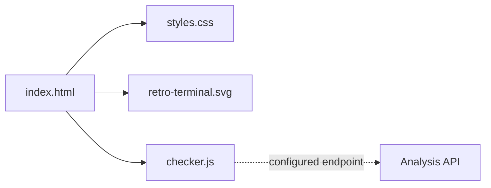
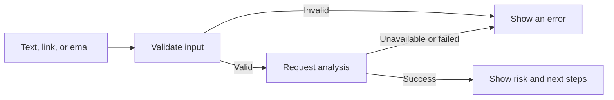

# ScamShield

ScamShield is a browser interface for checking suspicious messages, links, and emails. It uses HTML, CSS, and JavaScript.

## Installation

1. Clone the repository.

   ```sh
   git clone https://github.com/nourelhilo/scam-shield.git
   ```

2. Open `index.html` in a browser. For a local server, run this from the folder containing `index.html` with Python 3 installed.

   ```sh
   python -m http.server 4173 --bind 127.0.0.1
   ```

3. If you started the server, open [localhost:4173](http://127.0.0.1:4173).

## Structure



## Scan flow



## Connect the analyzer

Set `data-analysis-endpoint` on `#scan-form` in `index.html` and run the local server. The frontend sends `POST` with JSON `{ "type": "text", "content": "Your delivery is on hold." }`. Supported types are `text`, `url`, and `email`.

A successful response uses this shape:

```json
{
  "risk": "unknown",
  "summary": "There is too little information to assess this message.",
  "warnings": [],
  "recommendations": ["Check your delivery status in the retailer's official app."]
}
```

The risk values are `low`, `medium`, `high`, and `unknown`. If the API runs on a separate origin, configure CORS for the frontend origin.
