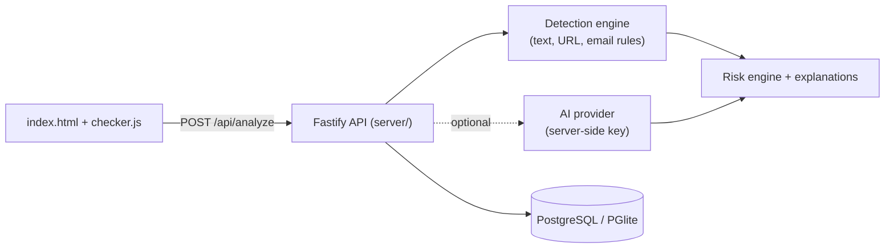
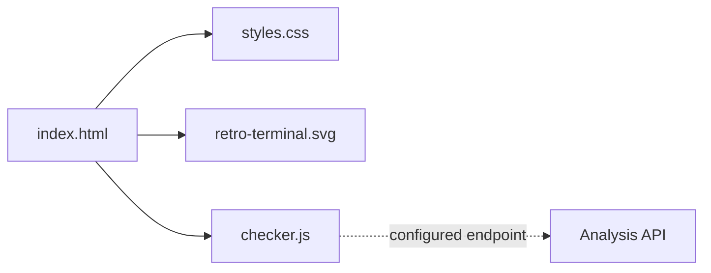
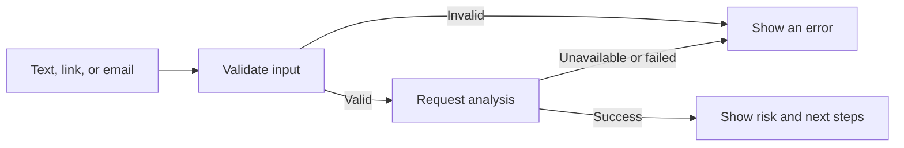

# ScamShield

ScamShield is a browser interface for checking suspicious messages, links, and emails, backed by an explainable scam-detection API. The frontend uses HTML, CSS, and JavaScript; the backend uses TypeScript on Node.js.

## 1. Project overview

Users paste a suspicious text message, link, or email (or upload a screenshot) and get a risk rating (`low`, `medium`, `high`, or `unknown`), the warning signs found with evidence, and safety recommendations. Results are an automated estimate: ScamShield never claims something is safe or definitively fraudulent.

## 2. Features

- Rule-based detection of urgency, threats, credential/OTP/bank/card requests, unusual payments, impersonation, fake deliveries, account-suspension notices, prizes, investment and job scams, phishing calls-to-action, and obfuscation tricks, in **English and Arabic**.
- Static URL analysis (look-alike brands, punycode/mixed scripts, IP hosts, embedded credentials, misleading subdomains, redirects, and more). URLs are never visited.
- Pasted-email sender consistency checks (explicitly unverified).
- Optional AI analysis (Anthropic Claude) that can only add evidence-backed findings.
- Accounts with email verification, password reset, opt-in scan history, downloadable reports, feedback, and account deletion.
- Educational articles, an admin API with audit logs, and screenshot OCR (optional).

## 3. Backend technology stack

TypeScript · Node.js ≥ 22.12 · Fastify 5 · Zod · PostgreSQL (`pg`) with embedded PGlite for development/tests · Argon2id · `@anthropic-ai/sdk` · `tldts` · `tesseract.js` · `nodemailer` · Vitest · ESLint.

## 4. Architecture



Details: [`docs/BACKEND_ARCHITECTURE.md`](docs/BACKEND_ARCHITECTURE.md).

### Frontend structure



### Scan flow



## 5. Folder structure

```
index.html, styles.css, checker.js, retro-terminal.svg   frontend (owned by the frontend developer)
server/          backend source (routes, detection, risk, ai, auth, repositories, db, ocr, reports, scripts)
tests/           unit/, integration/, security/, helpers/
docs/            backend documentation
FRONTEND_INTEGRATION.md   how to connect the frontend to the API
FRIEND_HANDOFF.md         current status and next steps
```

## 6. Installation

1. Clone the repository.

   ```sh
   git clone https://github.com/nourelhilo/scam-shield.git
   cd scam-shield
   ```

2. **Frontend only:** open `index.html` in a browser. For a local server, run this from the folder containing `index.html` with Python 3 installed, then open [localhost:4173](http://127.0.0.1:4173).

   ```sh
   python -m http.server 4173 --bind 127.0.0.1
   ```

3. **Backend (and frontend together):** with Node.js 22.12 or newer:

   ```sh
   npm install
   cp .env.example .env     # optional; defaults work for local development
   npm run dev              # http://127.0.0.1:3000 serves the page and the API
   ```

   No database server is needed locally: an embedded PostgreSQL (PGlite) is created in `.data/pglite` and migrated and seeded automatically.

## 7. Environment variables

All variables are server-only. They are documented in [`.env.example`](.env.example). The most important:

| Variable | Default | Purpose |
|---|---|---|
| `DATABASE_URL` | empty (uses PGlite) | PostgreSQL connection string; **required in production** |
| `AI_PROVIDER` / `ANTHROPIC_API_KEY` / `AI_MODEL` | `none` / — / `claude-opus-5-5` | Enable AI analysis |
| `CORS_ORIGINS` | dev: `127.0.0.1:4173`, `localhost:4173`, `:3000` | Allowed frontend origins |
| `PUBLIC_APP_URL` | `http://127.0.0.1:3000` | Base URL for links in emails |
| `MAIL_TRANSPORT` / `SMTP_URL` | `console` | Email delivery (`smtp` is required in production) |
| `REQUIRE_EMAIL_VERIFICATION` | `true` | Block sign-in until the email is verified |
| `OCR_ENABLED` | `false` | Enable screenshot analysis |
| `TRUST_PROXY` | `false` | Set behind a trusted reverse proxy |

## 8. Development commands

| Command | What it does |
|---|---|
| `npm run dev` | Start the API with auto-reload |
| `npm start` | Start the API |
| `npm test` | Run all tests |
| `npm run typecheck` / `npm run lint` / `npm run check` | Type check / lint / all checks |
| `npm run db:migrate` | Apply database migrations (forward-only) |
| `npm run db:seed` | Insert starter articles (idempotent) |
| `npm run admin:promote -- you@example.com [--revoke]` | Grant or revoke the admin role |

There is no build step: the server runs TypeScript directly.

## 9. API documentation

- Frontend guide with examples: [`FRONTEND_INTEGRATION.md`](FRONTEND_INTEGRATION.md)
- Field-level reference and rule catalogue: [`docs/API_DOCUMENTATION.md`](docs/API_DOCUMENTATION.md)

### Connect the analyzer

Run `npm run dev` and open `http://127.0.0.1:3000`; the served page is wired to `/api/analyze` automatically. Alternatively, set `data-analysis-endpoint` on `#scan-form` in `index.html` (for example `http://127.0.0.1:3000/api/analyze` when the page is served from `python -m http.server`). The frontend sends `POST` with JSON `{ "type": "text", "content": "Your delivery is on hold." }`. Supported types are `text`, `url`, and `email`.

A successful response includes this shape (plus richer fields such as `riskLevel`, `indicators`, `analysisMethod`):

```json
{
  "risk": "unknown",
  "summary": "There is too little information to assess this message.",
  "warnings": [],
  "recommendations": ["Check your delivery status in the retailer's official app."]
}
```

The risk values are `low`, `medium`, `high`, and `unknown`. If the API runs on a separate origin, list the frontend origin in `CORS_ORIGINS`.

## 10. Authentication

Email + password accounts. Passwords are hashed with Argon2id. Sign-in returns an opaque bearer token (only its hash is stored) that is sent as `Authorization: Bearer <token>`. Email verification and password reset use single-use, expiring tokens. Accounts are optional: analysis works without signing in.

## 11. Database setup

- **Development:** nothing to do (PGlite in `.data/pglite`).
- **Production:** create a PostgreSQL database, set `DATABASE_URL`, then run `npm run db:migrate` and `npm run db:seed`. Migrations are forward-only and never drop data.

Schema: [`docs/DATABASE_SCHEMA.md`](docs/DATABASE_SCHEMA.md).

## 12. Scam detection approach

1. **Normalise** text (Unicode NFKC, remove invisible characters, unify Arabic letter variants and digits, detect language).
2. **Run independent rules.** Each rule has an ID, severity, description, and evidence. Request rules require a request verb near a sensitive noun and are suppressed by negations, so "we will never ask for your password" is not flagged.
3. **Analyse every link** statically and, for emails, check sender consistency.
4. **Optionally add AI findings**, each of which must quote evidence found in the submission.
5. **Score:** low = 1, medium = 2, high = 3, with repeats in one category dampened. **HIGH** needs a score ≥ 6 across 2+ categories, or 2 high-severity indicators in different categories. **MEDIUM** needs a score ≥ 3 or one high-severity indicator. Otherwise **LOW**, or **UNKNOWN** when there is too little content. One keyword never decides a result, and no confidence percentages are produced.
6. **Explain** deterministically from the final indicators, with tailored recommendations.

## 13. AI configuration

Set `AI_PROVIDER=anthropic` and `ANTHROPIC_API_KEY` (server-side only). The default model is `claude-opus-5-5` (`AI_MODEL`). Requests use structured JSON output, low effort, a 12 s total timeout, at most 1 retry, and Anthropic's server-side refusal fallback. Without a key the API uses rules only and reports `analysisMethod: "rules"`; it never presents rule-based results as AI. If the provider fails, the response is still the rule-based result, with `ai.status: "failed"`.

## 14. Security and privacy

Raw submissions are never stored; history is opt-in; URLs are never fetched; inputs are validated and size-limited; rate limits apply; security headers, CORS allow-list, and log redaction are on. Full list and residual risks: [`docs/SECURITY.md`](docs/SECURITY.md).

## 15. Testing

`npm test` runs 301 tests (unit, integration on an in-memory PostgreSQL, and security). AI, email, and OCR are mocked in tests. See [`docs/TESTING.md`](docs/TESTING.md).

## 16. Known limitations

- Real AI provider calls, SMTP delivery, Arabic OCR, and a standalone PostgreSQL server have not been verified (see `docs/BACKEND_PROGRESS.md`).
- Rate limiting is in-memory per process (not distributed).
- Explanations are English only (Arabic input is analysed).
- Email sender details are pasted and unverifiable (no SPF/DKIM/DMARC).
- Reports are plain text/JSON (no PDF).
- Detection thresholds are hand-tuned, not calibrated on a labelled dataset.

## 17. Roadmap

1. Frontend: sign-in, history, feedback, articles, password-reset page.
2. Verify against real PostgreSQL, SMTP, and the Anthropic API; add a privacy notice for AI processing.
3. Shared rate-limit store and deployment.
4. Arabic explanations; more Arabic rules and articles.
5. Labelled evaluation set to calibrate thresholds; admin-reviewed feedback loop.
6. Data-retention job; optional managed identity provider; PDF reports.

## 18. Team responsibilities

| Area | Owner |
|---|---|
| Frontend: pages, design, styling, responsiveness, UX (`index.html`, `styles.css`, `checker.js`, `retro-terminal.svg`) | Developer 2 (frontend) |
| Backend: API, detection engine, AI integration, database, authentication, security, backend tests (`server/`, `tests/`, `docs/`) | Developer 1 (backend) |

## 19. GitHub collaboration workflow

- `main` holds working code. Pull before starting: `git pull --rebase origin main`.
- Prefer short-lived feature branches and pull requests (`feature/history-page`, `backend/…`); merge after tests pass (`npm run check`).
- Keep ownership boundaries: backend changes stay in `server/`, `tests/`, and `docs/`; frontend files are changed by the frontend owner (backend requests go in `FRONTEND_INTEGRATION.md`).
- Never commit `.env`, `.data/`, or `.cache/` (already in `.gitignore`). Never force-push `main`.
